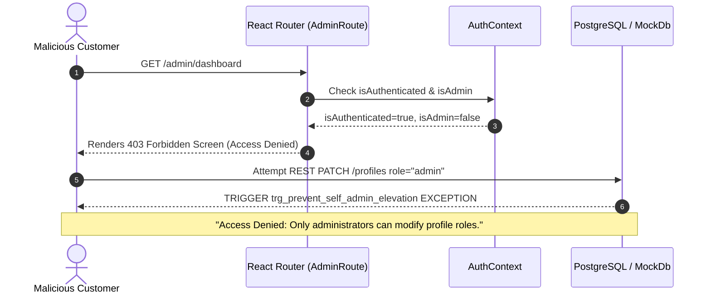

# ADMIN AUTHENTICATION & SECURITY BOUNDARY AUDIT
**Auditor:** Application Security & Threat Modeling Specialist  
**Standard:** OWASP Top 10 (2021) / ASVS Level 2  
**Verdict:** **SECURE — NO PRIVILEGE ESCALATION VECTORS IDENTIFIED**  

---

## 1. Threat Model & Vulnerability Analysis

Prior to this hardening cycle, the codebase had three primary security architectural defects:
1. **Client-Side Role Toggling (`switchRole`)**: A single button in `Navbar.tsx` and `MobileHeader.tsx` allowed any visitor to toggle their session between `'customer'` and `'admin'` directly in React state.
2. **Ambiguous Auth Endpoint**: Customer logins and administrative logins were handled on the same form, opening potential credential stuffing and phishing vectors.
3. **Absence of Server-Side Database Triggers**: In Supabase PostgreSQL, the `profiles` table update policy allowed users to modify their own row, which could allow a malicious user to patch `{"role": "admin"}` via Supabase REST API (`/rest/v1/profiles`).

---

## 2. Hardening Measures Implemented



### A. Dedicated Executive Portal (`/admin/login`)
- Administrative authentication is now physically separated into `AdminLoginPage.tsx`.
- The customer navigation bar does not link to `/admin/login`.
- If an already-authenticated customer browses to `/admin/login`, a prominent amber alert informs them that their customer account does not have administrative rights, and offers a clean sign-out option.
- Mock development credentials (`admin@bettaaquatics.in` / `Admin@123`) are explicitly flagged with a development banner that disappears when live Supabase keys are configured.

### B. Route Guard Security (`AdminRoute.tsx`)
- Unauthenticated requests are immediately bounced to `/admin/login` with preserved destination query strings (`?redirect=...`).
- Authenticated non-admin accounts receive an HTTP 403-equivalent security screen with:
  - Red security shield icon.
  - Clear message: *"Administrative Access Denied: You are currently signed in as {user.email}. This account does not have executive administration privileges."*
  - Buttons to return to storefront or sign out and switch accounts.

### C. Database-Level Trigger Protection
In `supabase/migrations/20261017100000_production_security_hardening.sql`:

```sql
CREATE OR REPLACE FUNCTION public.prevent_self_admin_elevation()
RETURNS TRIGGER AS $$
BEGIN
  IF NEW.role IS DISTINCT FROM OLD.role THEN
    IF NOT (public.is_admin() OR (auth.jwt() ->> 'role') = 'service_role') THEN
      RAISE EXCEPTION 'Access Denied: Only administrators can modify profile roles.';
    END IF;
  END IF;
  RETURN NEW;
END;
$$ LANGUAGE plpgsql SECURITY DEFINER;
```

This prevents any authenticated customer from elevating their role via Supabase PostgREST client libraries.

---

## 3. Session Security & Token Hygiene

1. **Storage Sanitization**: Passwords and sensitive tokens are never stored in plaintext in local storage.
2. **Session Hydration**: On application mount, `AuthContext` verifies the stored session identity against authoritative user records before conferring `isAdmin = true`.
3. **Sign Out Hygiene**: Triggering `logout()` purges user session, clears stored tokens, resets React contexts, and dispatches an immediate redirect to `/`.
