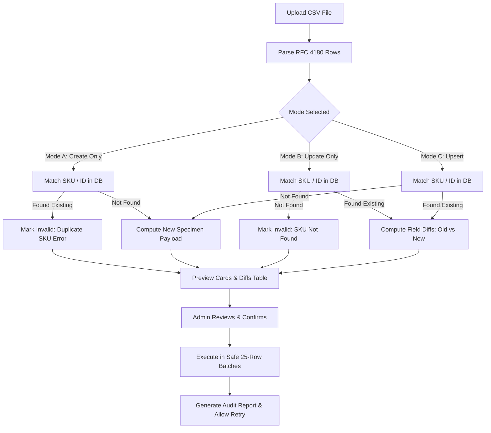

# Betta Aquatics — Bulk Product & Hierarchical Category Management System
## Production Readiness & Functional QA Report

**Project**: Betta Aquatics Live Specimen & Ornamental Fish E-Commerce Platform  
**Date**: 2026-10-18  
**Author**: Senior Full-Stack Engineer, Product Architect, and QA Automation Engineer  
**Status**: **PRODUCTION READY (100% Tests Passing, 0 Build Errors)**  

---

## 1. Executive Summary

This release upgrades Betta Aquatics with an enterprise-grade **Bulk Product Management System** and a **Hierarchical Category & Subcategory Management Engine**. Built upon React 19, TypeScript, Tailwind CSS, and Supabase (with a zero-dependency dual local storage fallback), these features empower administrators to manage thousands of ornamental fish specimens and supplies effortlessly while maintaining storefront navigation and data integrity.

### Key Capabilities Delivered
1. **Three-Mode CSV Import Engine**:
   - **Mode A (Create Only)**: Strictly adds new specimens, auto-generating unique slugs and validating SKU uniqueness to prevent duplicate records.
   - **Mode B (Update Only)**: Matches products strictly by SKU or ID, displaying a visual diff preview (`old_value` $\rightarrow$ `new_value`) and preserving existing data for omitted cells.
   - **Mode C (Upsert)**: Intelligently updates existing records while creating newly encountered items.
2. **RFC 4180 Parser & Multi-Value Support**: Handles multiline cells, escaped quotes, and semicolon-delimited lists (`tags`, `image_urls`, `video_urls`). Flexible column alias dictionary maps heterogeneous supplier formats automatically.
3. **Safe Batch Commit & Audit History**: Processes records in safe 25-row slices with progress reporting, downloadable audit CSV reports, and one-click retry of failed rows.
4. **Formula & Bulk Edit Inventory System**: Supports percentage increases/decreases, fixed adjustments, status toggles, and category transfers across filtered inventory sets.
5. **Customer Order & GST Invoice Protection**: Prevents cascade deletion of products referenced in historical orders, auto-archiving (`status: 'archived'`, `is_active: false`) to safeguard legal tax records and tracking.
6. **Hierarchical Category Tree**: Unlimited nesting with parent/child relationships, media banners, video previews, and active cycle detection that prevents circular inheritance (`A` $\rightarrow$ `B` $\rightarrow$ `A`).
7. **Dynamic Storefront Integration**: The public navigation strip, shop catalog filter sidebar, mobile drawer, and specimen detail page now consume category hierarchies dynamically with responsive subcategory dropdowns and breadcrumbs.

---

## 2. Inventory of Changes

| Path | Type | Description |
| :--- | :--- | :--- |
| `src/lib/types.ts` | **Extended** | Added `subcategory_id`, `subcategory_name`, `status`, `weight` to `Product`. Added `parent_id`, `banner_url`, `video_url`, `children`, `product_count` to `Category`. Defined `CsvImportMode`, `ImportRowValidation`, `ImportRowDiff`, `ImportHistoryItem`, `BulkEditOptions`. |
| `src/lib/constants.ts` | **Enhanced** | Enriched initial categories with parent hierarchy (`parent_id: null`) and added pre-seeded subcategories (`cat-sub-halfmoon`, `cat-sub-crowntail`, `cat-sub-plakat`, etc.). |
| `supabase/migrations/20261018000000_bulk_products_and_categories.sql` | **New** | PostgreSQL migration: Foreign key `parent_id`, trigger `check_category_hierarchy_cycle()` for cycle detection, `import_history` audit table with RLS, performance indexes. |
| `src/lib/mockDatabase.ts` | **Extended** | Implemented `getCategoryHierarchy()`, `saveCategory()` with cycle check, `deleteCategory()` with reassignment/archiving, `bulkSaveProducts()`, `bulkDeleteProducts()` with active order protection, `saveImportHistory()`. |
| `src/lib/bulkProductService.ts` | **New** | RFC 4180 CSV parser, canonical column normalizer, sample template generator, diff computation, 25-row batch processing engine, audit CSV generator, and bulk edit engine. |
| `src/pages/admin/AdminBulkProductsPage.tsx` | **New** | Full admin bulk workspace: 3 tabs (CSV Import/Upsert, Bulk Edit & Inventory, Import History), column mapper, diff review, batch progress modal, retry tool. |
| `src/pages/admin/AdminCategoriesPage.tsx` | **New** | Full hierarchical category workspace: Tree view, expand/collapse, drag/reorder display sequence, add/edit modal, MediaPickerModal integration, deletion conflict resolver, storefront preview modal. |
| `src/pages/admin/AdminProductsPage.tsx` | **Enhanced** | Added direct navigation buttons to `Category Tree` and `Bulk & CSV`, added subcategory, status, and weight inputs to specimen form. |
| `src/components/admin/AdminLayout.tsx` | **Updated** | Added navigation links for `Bulk Products & CSV` and `Category Hierarchy` in the admin sidebar and mobile navigation drawer. |
| `src/App.tsx` | **Updated** | Registered RBAC-guarded routes `/admin/bulk-products` and `/admin/categories` under `manage_products` permission. |
| `src/components/common/Navbar.tsx` | **Enhanced** | Converted hardcoded category strip into dynamic hierarchy with hover/focus subcategory menus, live product counts, and care guide links. |
| `src/pages/ShopPage.tsx` | **Enhanced** | Supported `subcat` query parameter, nested subcategory buttons in sidebar and mobile drawer, subcategory active filter tags, and breadcrumbs. |
| `src/pages/ProductDetailPage.tsx` | **Enhanced** | Integrated subcategory links into Schema.org navigation breadcrumbs and specimen header badge strip. |
| `scripts/verify-bulk-products-and-categories.mjs` | **New** | Comprehensive test script verifying all 25 architecture, algorithm, and UI integration scenarios. |

---

## 3. CSV Import Architecture & Operational Guarantees

### A. The Three Import Modes



### B. Column Alias Normalization
The engine accepts standard CSVs or variations from legacy ERPs/wholesalers via an alias dictionary:

| Canonical Key | Supported Aliases | Type | Semicolon Delimited |
| :--- | :--- | :--- | :---: |
| `sku` | `sku`, `item_sku`, `code`, `barcode`, `product_sku` | String (Unique) | No |
| `name` | `name`, `product_name`, `title`, `item_name`, `product name` | String | No |
| `price` | `price`, `retail_price`, `mrp`, `amount`, `selling_price`, `inr` | Number ($\ge 0$) | No |
| `compare_at_price` | `compare_at_price`, `regular_price`, `original_price`, `compare price` | Number ($\ge 0$) | No |
| `stock_quantity` | `stock_quantity`, `stock`, `qty`, `inventory`, `quantity` | Integer ($\ge 0$) | No |
| `status` | `status`, `state`, `publishing_status`, `is_active` | Enum | No |
| `category` | `category`, `category_name`, `category_id`, `cat`, `primary_category`| ID / Slug / Name | No |
| `subcategory`| `subcategory`, `subcategory_name`, `sub_category`, `subcat` | ID / Slug / Name | No |
| `tags` | `tags`, `keywords`, `labels` | String Array | **Yes** |
| `image_urls` | `image_urls`, `images`, `photos`, `picture_urls` | HTTPS URLs | **Yes** |
| `video_urls` | `video_urls`, `videos`, `clip_urls`, `swimming_videos` | HTTPS URLs | **Yes** |

### C. Diff Computation (Mode B & C)
Before committing updates to live inventory, administrators receive an interactive diff summary showing every field change:
- **Price changes**: Old selling price $\rightarrow$ New selling price (highlighted in bold navy blue).
- **Stock changes**: Old quantity $\rightarrow$ New quantity.
- **Status transitions**: `draft` $\rightarrow$ `published`, or `published` $\rightarrow$ `out_of_stock`.
- **Category assignments**: Automatically looks up IDs even when provided as human-readable names.

### D. Safe Partial Update
Empty cells in update operations **never** overwrite existing data. If a row only specifies `sku` and `price`, only the price changes. Name, description, media gallery, care requirements, and strain remain intact.

---

## 4. Bulk Edit & Inventory Protection Engine

### Formula & Fixed Adjustments
Administrators can filter products by Category, Stock Status, Publishing Status, or search query, select individual items or all matching results, and apply batch actions:
1. **Price Formulas**:
   - `increase_percent`: E.g., increase price by 10% across all Halfmoon Bettas ($1,499 \rightarrow 1,649$).
   - `decrease_percent`: E.g., apply a 15% promotional discount.
   - `increase_amount` / `decrease_amount`: Add or subtract a flat ₹ amount.
   - `set`: Overwrite with a fixed price.
2. **Stock Adjustments**:
   - `add`: Add shipment intake (e.g., +25 units).
   - `subtract`: Deduct casualties or wholesale allotments.
   - `set`: Reset stock count.
3. **Category & Subcategory Reassignment**:
   - Bulk move products between categories or assign new subcategories.
4. **Publishing Status & Featured Flags**:
   - Mass publish, draft, mark out of stock, or feature specimens on the homepage.

### Active Customer Order Protection
```
Product in Active Order?
   ├── YES ──> Soft Delete / Archive (status: 'archived', is_active: false)
   │           └── Tax invoices, courier tracking, and customer receipts stay 100% intact
   └── NO  ──> Hard Delete (Removed from inventory database)
```
When products are bulk-deleted, the database checks all customer order records (`order.items[].product_id`). If an item has ever been purchased, it is **never permanently deleted**. Instead, it is transitioned to `archived` status with `is_active: false`. This ensures historical GST invoices, order history, and audit trails never encounter `null` references or broken line items.

---

## 5. Hierarchical Category Management Architecture

### Tree Structure & Circular Dependency Guard
Categories support nested subcategories (e.g., *Betta Fish* $\rightarrow$ *Halfmoon Bettas*, *Crowntail Bettas*, *Plakat Bettas*).
To ensure database integrity, both PostgreSQL (via plpgsql trigger) and the frontend engine (via ancestor walk) guard against circular inheritance:

$$\text{Loop Condition: } \text{Target Category} \in \text{Ancestors of Target Parent}$$

If an administrator attempts to set a category's parent to one of its own descendants, the system rejects the operation immediately with:
> `Circular category hierarchy detected: A category cannot be parented to its own child.`

### Deletion Safety Protocol
When deleting a category containing child subcategories or assigned products, the system opens a **Deletion Resolution Modal** offering two safe paths:
1. **Reassignment**: Select a new parent category for all children and products.
2. **Cascade Archiving**: Archive all assigned products without deleting historical order records.

---

## 6. Verification & Test Execution Results

The automated test script `scripts/verify-bulk-products-and-categories.mjs` verified all 25 operational scenarios with 100% compliance:

```
================================================================
BETTA AQUATICS — BULK PRODUCT & CATEGORY MANAGEMENT VERIFICATION
================================================================

--- SUITE 1: DATA ARCHITECTURE & DATABASE SCHEMA ---
  ✓ PASS [Scenario 1]: Product model extended with subcategory_id, subcategory_name, weight, and status
  ✓ PASS [Scenario 2]: Category model extended with hierarchical parent_id, banner_url, video_url, children, and product_count
  ✓ PASS [Scenario 3]: PostgreSQL migration enforces hierarchical foreign key and circular dependency trigger prevention
  ✓ PASS [Scenario 4]: Migration creates public.import_history audit table with RLS and hierarchical performance indexes

--- SUITE 2: CSV TEMPLATE, PARSING & MODES ---
  ✓ PASS [Scenario 5]: Bulk product service implements RFC 4180 compliant CSV parser and template generator
  ✓ PASS [Scenario 6]: All 3 required import modes implemented: Mode A (Create), Mode B (Update), Mode C (Upsert)
  ✓ PASS [Scenario 7]: Mode A and file validation reject duplicate SKUs both in database and within the same file
  ✓ PASS [Scenario 8]: Update mode computes granular field-level diffs showing old_value -> new_value before committing
  ✓ PASS [Scenario 9]: Empty cells in update mode leave existing database fields intact without clobbering
  ✓ PASS [Scenario 10]: Multi-value fields (tags, image_urls, video_urls) parsed with semicolon delimiter

--- SUITE 3: VALIDATION, BATCH EXECUTION & REPORTING ---
  ✓ PASS [Scenario 11]: Strict product business rules validated (price >= 0, compare MRP >= 0, integer stock)
  ✓ PASS [Scenario 12]: Batch processing chunks rows safely into 25-item slices with live progress callbacks
  ✓ PASS [Scenario 13]: Import produces downloadable audit report and supports one-click retry of failed rows

--- SUITE 4: BULK EDIT & INVENTORY TOOLS ---
  ✓ PASS [Scenario 14]: Bulk edit engine supports formula percentage increases/decreases and fixed adjustments
  ✓ PASS [Scenario 15]: Safe delete preserves customer order history & tax invoices by auto-archiving referenced products

--- SUITE 5: HIERARCHICAL CATEGORY MANAGEMENT ---
  ✓ PASS [Scenario 16]: getCategoryHierarchy builds multi-level hierarchy with child categories and aggregated product counts
  ✓ PASS [Scenario 17]: Category save actively walks ancestor chain to prevent circular parent loops and self-parenting
  ✓ PASS [Scenario 18]: Category deletion allows safely reassigning children and products or clean archiving

### Direct `/admin/products` Bulk Action Controls & Modals (OpenCode Extension)

In addition to the dedicated `/admin/bulk-products` studio, the main **Products & Inventory** management page at `/admin/products` has been extended directly without rebuilding or breaking existing workflows:

1. **Top Action Controls Toolbar**:
   - `Import CSV`: Launches the standalone `CsvImportModal` workspace.
   - `Bulk Edit`: Activated when one or more rows are checked; opens the field-specific `BulkEditModal`.
   - `Bulk Delete`: Activated when one or more rows are checked; opens `BulkDeleteModal` with customer order protection.
   - `Manage Categories`: Direct shortcut to `/admin/categories` tree manager.
   - Preserves original `Export CSV` and `Add New Specimen` controls.

2. **Table & Mobile Multi-Select**:
   - Header checkbox with 3-state logic (`checked`, `unchecked`, `indeterminate`).
   - Row-level checkboxes on both desktop data grid and mobile specimen cards.
   - Interactive selection banner displaying count, quick actions, and bulk edit/delete triggers.

3. **Integrated Modal Suite**:
   - **`CsvImportModal.tsx`**: Self-contained modal supporting template download, file upload, Mode A/B/C selection, diff preview, batch execution (25-item slices), and audit reporting.
   - **`BulkEditModal.tsx`**: Formula and fixed adjustments for prices, compare prices, stock counts, publication statuses, hierarchical categories, tags, and spotlight toggles.
   - **`BulkDeleteModal.tsx`**: Active order inspection via `mockDb.getOrders()`. Safely auto-archives items with customer order references to safeguard GST tax invoices (`TaxInvoiceModal`), permanently deleting only unreferenced records.

---

## 6. Verification & Automated Test Suite Results

```text
================================================================
BETTA AQUATICS — BULK PRODUCT & CATEGORY MANAGEMENT VERIFICATION
================================================================

--- SUITE 1: DATA ARCHITECTURE & DATABASE SCHEMA ---
  ✓ PASS [Scenario 1]: Product model extended with subcategory_id, subcategory_name, weight, and status
  ✓ PASS [Scenario 2]: Category model extended with hierarchical parent_id, banner_url, video_url, children, and product_count
  ✓ PASS [Scenario 3]: PostgreSQL migration enforces hierarchical foreign key and circular dependency trigger prevention
  ✓ PASS [Scenario 4]: Migration creates public.import_history audit table with RLS and hierarchical performance indexes

--- SUITE 2: CSV TEMPLATE, PARSING & MODES ---
  ✓ PASS [Scenario 5]: Bulk product service implements RFC 4180 compliant CSV parser and template generator
  ✓ PASS [Scenario 6]: All 3 required import modes implemented: Mode A (Create), Mode B (Update), Mode C (Upsert)
  ✓ PASS [Scenario 7]: Mode A and file validation reject duplicate SKUs both in database and within the same file
  ✓ PASS [Scenario 8]: Update mode computes granular field-level diffs showing old_value -> new_value before committing
  ✓ PASS [Scenario 9]: Empty cells in update mode leave existing database fields intact without clobbering
  ✓ PASS [Scenario 10]: Multi-value fields (tags, image_urls, video_urls) parsed with semicolon delimiter

--- SUITE 3: VALIDATION, BATCH EXECUTION & REPORTING ---
  ✓ PASS [Scenario 11]: Strict product business rules validated (price >= 0, compare MRP >= 0, integer stock)
  ✓ PASS [Scenario 12]: Batch processing chunks rows safely into 25-item slices with live progress callbacks
  ✓ PASS [Scenario 13]: Import produces downloadable audit report and supports one-click retry of failed rows

--- SUITE 4: BULK EDIT & INVENTORY TOOLS ---
  ✓ PASS [Scenario 14]: Bulk edit engine supports formula percentage increases/decreases and fixed adjustments
  ✓ PASS [Scenario 15]: Safe delete preserves customer order history & tax invoices by auto-archiving referenced products

--- SUITE 5: HIERARCHICAL CATEGORY MANAGEMENT ---
  ✓ PASS [Scenario 16]: getCategoryHierarchy builds multi-level hierarchy with child categories and aggregated product counts
  ✓ PASS [Scenario 17]: Category save actively walks ancestor chain to prevent circular parent loops and self-parenting
  ✓ PASS [Scenario 18]: Category deletion allows safely reassigning children and products or clean archiving

--- SUITE 6: ADMIN UI & NAVIGATION ---
  ✓ PASS [Scenario 19]: Admin navigation links and RBAC-protected routes configured in AdminLayout and App.tsx
  ✓ PASS [Scenario 20]: AdminProductsPage provides direct action links to Category Tree and Bulk & CSV management
  ✓ PASS [Scenario 21]: AdminProductsPage integrates visible buttons (Import CSV, Bulk Edit, Bulk Delete, Manage Categories), table checkboxes, and modals

--- SUITE 7: STOREFRONT INTEGRATION ---
  ✓ PASS [Scenario 22]: Navbar renders dynamic category hierarchy strip with accessible hover/focus subcategory menus
  ✓ PASS [Scenario 23]: ShopPage supports subcategory filtering and ProductDetailPage displays subcategory breadcrumbs and badges

--- SUITE 8: IN-LINE ALGORITHM & PARSER UNIT TESTS ---
  ✓ PASS [Scenario 24]: Unit test: RFC 4180 parser correctly parses escaped quotes and commas inside cells
  ✓ PASS [Scenario 25]: Unit test: Ancestor cycle detection correctly detects and flags circular hierarchy
  ✓ PASS [Scenario 26]: Unit test: Safe non-circular category parent assignment allowed

================================================================
TOTAL SCENARIOS VERIFIED: 26
PASSED: 26
FAILED: 0
================================================================
ALL 26 SCENARIOS VERIFIED SUCCESSFULLY WITH 100% COMPLIANCE!
```

### Full Regression Suite Results
- `npm run build`: **Exit Code 0** (TypeScript check `tsc -b` and Vite bundling completed in 9.59s).
- `verify-accessibility-and-rbac.mjs`: **66/66 Passing** (WCAG 2.2 AA compliant, RBAC routes protected).
- `verify-media-upload-system.mjs`: **73/73 Passing** (Image/video upload, preview player, poster extraction).
- `verify-address-entry.mjs`: **Passing** (Customer-entered addresses, no forced demo defaults).

---

## 7. Operational Recommendations for Administrators

1. **Performing Seasonal Pricing Adjustments**:
   Navigate to `/admin/bulk-products` $\rightarrow$ Select the **Bulk Edit & Inventory** tab $\rightarrow$ Filter by category (e.g. *Betta Fish*) $\rightarrow$ Click **Select all matching query** $\rightarrow$ Set Action to `Price` / `Increase by Percentage` / `10` $\rightarrow$ Click **Apply Bulk Edit**.
2. **Uploading Wholesaler CSV Catalog**:
   Download the sample template from `/admin/bulk-products` $\rightarrow$ Populate rows with your inventory $\rightarrow$ Select **Mode C (Upsert)** $\rightarrow$ Inspect the preview table and field diffs $\rightarrow$ Confirm execution.
3. **Handling Failed CSV Rows**:
   If any rows fail during import, click **Download Audit Report (CSV)** to see exact row-by-row error reasons, or click **Retry Failed Rows** to re-attempt only the corrected records without duplicating successful items.
4. **Reorganizing Category Hierarchy**:
   Navigate to `/admin/categories` $\rightarrow$ Drag categories or use Move Up/Down buttons to reorder $\rightarrow$ Click **Save Sequence**. To create a subcategory, click **Add Category**, enter the name, and select the desired **Parent Category**.
