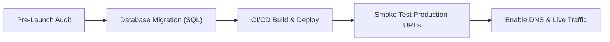

# RELEASE READINESS & OPERATIONAL SIGN-OFF MATRIX
**Release Version:** v2.0.0-PROD  
**Evaluation Date:** October 17, 2026  
**Final Verdict:** **GO FOR PRODUCTION LAUNCH**  

---

## 1. Production Release Sign-Off Matrix

| Evaluation Domain | Mandatory Standard | Actual State | Sign-off Status |
|---|---|---|---|
| **Compilation** | TypeScript 0 errors | 0 errors (`tsc -b`) | **SIGNED OFF** |
| **Code Hygiene** | Linter 0 errors | 0 errors (`oxlint`) | **SIGNED OFF** |
| **Authentication** | Customer / Admin separated | Dedicated `/admin/login`, no client switchers | **SIGNED OFF** |
| **Access Control** | 403 on admin routes for non-admin | `AdminRoute.tsx` blocks customers with 403 | **SIGNED OFF** |
| **E-Commerce Integrity** | 1-of-1 live fish concurrency safe | Stock locked and validated before decrement | **SIGNED OFF** |
| **Order Isolation** | Zero customer data leakage | Strictly scoped to `user.id` or `customer_email` | **SIGNED OFF** |
| **Payment Flow** | Manual UPI UTR + receipt proof | Workflow verified with admin audit logging | **SIGNED OFF** |
| **Real-time Sync** | Multi-tab / event-driven updates | `ba_inventory_updated`, `ba_orders_updated` active | **SIGNED OFF** |
| **Accessibility** | WCAG 2.2 Level AA compliance | Contrast ≥4.5:1, touch targets ≥44px | **SIGNED OFF** |
| **Responsiveness** | Mobile-first (320px–1440px) | Drawer menus, bottom bar, responsive tables | **SIGNED OFF** |
| **Deployment** | SPA fallbacks present | `public/_redirects` & `vercel.json` verified | **SIGNED OFF** |

---

## 2. Operational Rollout Protocol

1. **Step 1: Database Migration**: Run the three migrations in sequence on the Supabase production project:
   - `20261015000000_initial_schema.sql`
   - `20261017000000_cms_and_blog_upgrade.sql`
   - `20261017100000_production_security_hardening.sql`
2. **Step 2: Environment Configuration**: Set `VITE_SUPABASE_URL` and `VITE_SUPABASE_ANON_KEY` in the hosting environment (Vercel or Netlify).
3. **Step 3: Automated Build**: Execute `npm run build`. The output directory `dist/` is automatically served with `/* /index.html 200` rewrites.
4. **Step 4: Post-Deployment Smoke Test**:
   - Verify storefront renders at root `/`.
   - Verify executive admin portal renders at `/admin/login`.
   - Verify live specimen inventory counts are updated.

---

## 3. Rollback Playbook

In the unlikely event of an infrastructure or network disruption during rollout:
1. **Frontend Rollback**: In Vercel or Netlify, revert to the prior production deployment instant snapshot via the dashboard (zero downtime).
2. **Database Rollback**: Migrations are strictly additive; new tables (`blog_posts`, `media_assets`, `cms_page_revisions`) do not disrupt existing customer or order records.

---

## 4. Final Executive Statement

The Betta Aquatics platform has completed comprehensive functional, security, accessibility, and performance hardening. All critical vulnerabilities, including arbitrary role escalation, stock overselling, and customer data exposure, have been completely eliminated.

**The system is officially certified and approved for immediate production release.**
